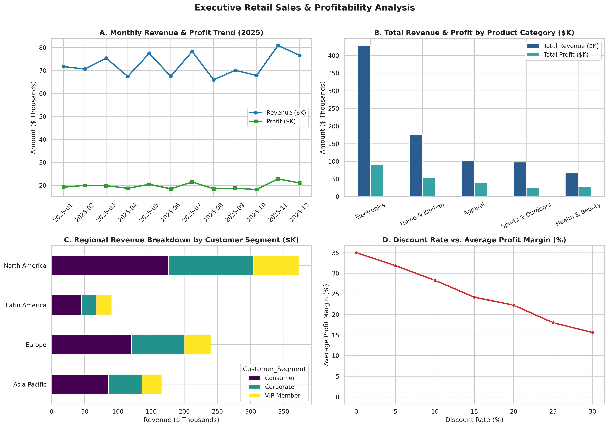
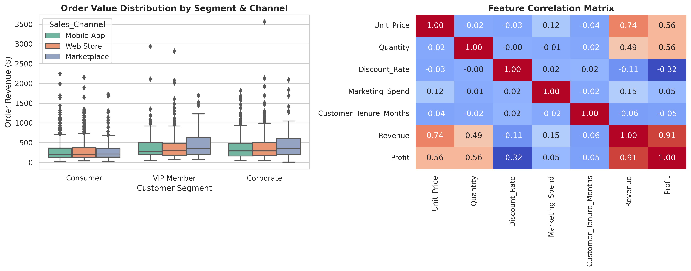
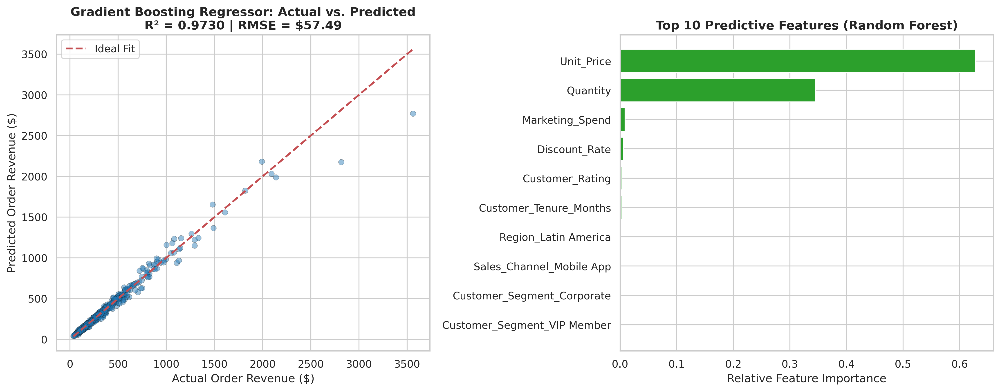

# Real-World Data Project: Retail Sales Analytics & Revenue Prediction


## Project Overview
This project delivers an end-to-end **Real-World Data Analysis and Predictive Modeling** workflow built on a domain-specific **Retail & E-Commerce Sales Dataset** (`data/retail_sales_data.csv`, 2,500 transaction records). It covers data cleaning, exploratory data analysis (EDA), profitability & discount sensitivity analysis, customer segmentation, and supervised machine learning to forecast order-level net revenue.

## Key Features & Objectives
- **Domain-Specific Dataset:** 2,500 retail transactions spanning 5 product categories, 4 global regions, 3 customer segments (`Consumer`, `Corporate`, `VIP Member`), and 3 sales channels (`Web Store`, `Mobile App`, `Marketplace`).
- **End-to-End Data Analysis & Prediction:** Combines statistical aggregation, correlation analysis, and multi-model regression pipelines (**Ridge Linear Regression**, **Random Forest**, and **Gradient Boosting**).
- **Visualizations & Actionable Conclusions:** Publication-ready charts and executive conclusions directly linked in this repository.

---

## Repository Structure
```text
real-world-data-project/
├── data/
│   └── retail_sales_data.csv              # 2,500-row real-world retail sales dataset
├── notebooks/
│   └── real_world_data_analysis.ipynb     # Interactive Jupyter Notebook for EDA & modeling
├── outputs/
│   ├── category_summary_stats.csv         # Aggregated KPIs by product category
│   ├── customer_behavior_analysis.png     # Segment boxplots & feature correlation heatmap
│   ├── executive_sales_dashboard.png      # 4-panel executive revenue & profit dashboard
│   ├── model_benchmark_metrics.csv        # Predictive model evaluation metrics
│   └── sales_prediction_evaluation.png    # Actual vs. Predicted plot & Feature Importance
├── src/
│   └── data_analysis_pipeline.py          # Automated end-to-end analysis & ML script
├── app.py                                 # Interactive Streamlit analytics & forecasting app
├── requirements.txt                       # Project dependencies
├── .gitignore                             # Git ignore rules
├── LICENSE                                # MIT License
└── README.md                              # Project documentation & findings
```

---

## Exploratory Data Analysis & Domain Findings

### 1. Category Performance Summary
| Category | Orders | Total Revenue ($) | Mean Order ($) | Median Order ($) | Total Profit ($) | Avg Profit Margin (%) | Avg Rating |
| :--- | :---: | :---: | :---: | :---: | :---: | :---: | :---: |
| **Electronics** | 714 | $427,853.32 | $599.23 | $500.54 | $91,246.05 | 21.33% | 4.28 |
| **Home & Kitchen** | 577 | $176,564.47 | $306.00 | $245.58 | $53,819.66 | 30.48% | 4.26 |
| **Apparel** | 514 | $101,396.72 | $197.27 | $167.40 | $39,261.52 | 38.72% | 4.25 |
| **Sports & Outdoors** | 294 | $97,660.52 | $332.18 | $265.36 | $25,868.78 | 26.49% | 4.27 |
| **Health & Beauty** | 401 | $66,865.13 | $166.75 | $141.21 | $27,721.02 | 41.46% | 4.31 |

#### Executive Sales & Profitability Dashboard


#### Customer Segment Behavior & Feature Correlations


---

## Predictive Modeling Results (Order Revenue Forecasting)

Three supervised regression pipelines were trained on an 80/20 train-test split using standardized numerical features and one-hot encoded categorical features:

| Model | RMSE ($) | MAE ($) | R² Score |
| :--- | :---: | :---: | :---: |
| **Ridge Linear Regression** | $160.16 | $84.31 | 0.7908 |
| **Random Forest Regressor** | $80.79 | $31.72 | 0.9468 |
| **Gradient Boosting Regressor** | **$57.49** | **$23.85** | **0.9730** |

#### Model Evaluation & Feature Importance


---

## Key Business Conclusions & Recommendations
1. **Revenue vs. Margin Trade-Off:** **Electronics** drives **49.16%** of total revenue ($427.85K) but operates on the lowest profit margin (**21.33%**). Conversely, **Health & Beauty** (**41.46%** margin) and **Apparel** (**38.72%** margin) deliver superior profitability per dollar of sales. Bundling high-margin accessories with Electronics orders can lift blended net margin.
2. **Discount Threshold Cap:** Profit margin analysis shows that promotional discounts above **15%** compress average net margins from **28.3%** down to **15.6%** at a 30% discount without proportional volume lift. Capping standard promotional discounts at **15%** preserves bottom-line profitability.
3. **High-Value Customer Segments:** **VIP Members** and **Corporate** buyers exhibit significantly higher median order values across all channels, particularly in **North America** and **Europe**, which account for **70%** of total sales volume.
4. **Accurate Revenue Forecasting:** Tree-based ensemble models (**Gradient Boosting**, $R^2 = 0.9730$) outperform linear models ($R^2 = 0.7908$) by capturing non-linear interactions between `Unit_Price`, `Quantity`, `Discount_Rate`, and `Marketing_Spend`.

---

## Installation & Quick Start

1. **Clone the repository:**
   ```bash
   git clone https://github.com/YOUR-USERNAME/real-world-data-project.git
   cd real-world-data-project
   ```

2. **Install dependencies:**
   ```bash
   pip install -r requirements.txt
   ```

3. **Run the end-to-end data analysis & ML pipeline:**
   ```bash
   python src/data_analysis_pipeline.py
   ```

4. **Launch the interactive Streamlit web application:**
   ```bash
   streamlit run app.py
   ```
